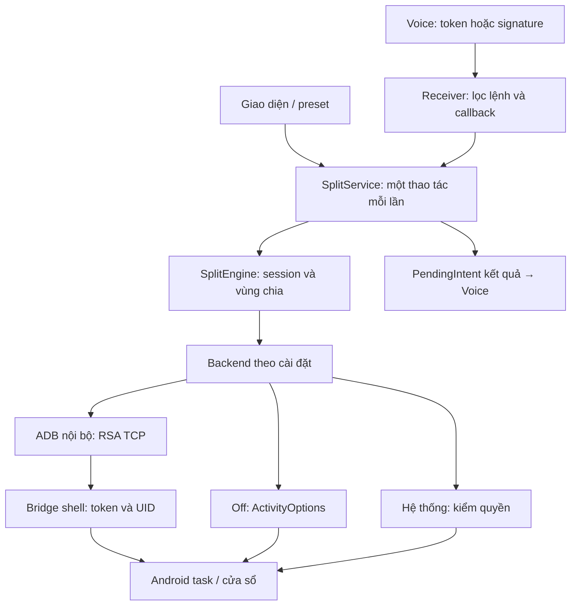

# Kiến trúc THT Split 0.2

## Tối ưu0.3.11
AppPicker dùng pool2 luồng để đọc launcher/label/icon, hàng ListView tái dùng,
LruCache64 ConstantState theo package+lastUpdateTime và bỏ kết quả khi dialog
đóng. Không cache danh sách ứng dụng giữa các lần mở.
DownloadStream lõi kiểm cap64MB/độ dài/SHA/interruption; ApkUpdates phát tiến
trình giai đoạn. MainActivity cập nhật UI mỗi300ms, Ẩn không hủy tải. Xác minh
APK thật và PackageInstaller vẫn giữ; org.json mới chỉ là dependency kiểm thử.
SettingsSnapshot là allowlist portable immutable; SettingsBackup JSON schema1
kiểm UTF-8/1MB/độ sâu16/100 cặp trước khi ghi một SharedPreferences commit.
Không clear kho preferences; không đụng credential/policy/session/rollback.
RESTORING giữ trong lúc ghi, SplitService chặn lệnh mới trừ các lệnh kết thúc.
Overlay fingerprint theo geometry/density/options; detach/attach các view được
cache, đổi cấu hình thì clear. Grip đọc LayoutParams hiện tại mỗi lần kéo.
PerformanceLog dùng monotonic clock, namespace riêng,20 mẫu cục bộ; chỉ tên
thao tác/backend/thời gian/thành công, không command hoặc credential. Thời gian
kết thúc worker không chứng minh UI frame đã vẽ hoặc animation mượt.

## Worker GitHub API06/10
GitHub PAT chỉ ở Worker. CONTROL lưu global config/update-settings và cache
GitHub độc lập; metadata refresh không ghi global policy, đọc lại sau network
để không trả enabled cũ khi admin đã khóa. Cache5m/single flight/persistent,
lỗi giữ snapshot tốt; repo/cert/channel đổi vô hiệu approval cũ. Chỉ 5 APK duyệt
được proxy; ID tùy ý không gọi API. GET APK stream cap64MB/kích thước, không
forward auth qua redirectCDN và không trả signed URL. CI tạo manifest từ APK
đã kiểm signer; Worker pin manifest, app verify SHA và signer binary thật.
API config shape vẫn tương thích0.3.6+, source manual giữ được. Admin mật khẩu
có ADMIN_PASSWORD alias nhưng không cần license/VIN/key nhập trong app.

## Startup0.3.8 — ưu tiên hơn tối ưu0.3.5 bên dưới
Khôi phục grace1s trong remote shell trước bootstrap marker; ADB shell được giữ
mở trong khoảng này. Sau shellCLSE/ADBclose:12 poll250ms. PING đầu vẫn nhanh
khi Bridge sẵn sàng. Không thay grace bằng chờ ở app sau khi shell đã đóng.

## Kết nối/UI0.3.7
MainActivity có executor mạng riêng cho Worker/APK, executor thao tác cục bộ
cho ADB/freeform. Dialog tiến trình500ms lấy connection_status; một check mỗi
lần, khóa đổi method/endpoint cho tới kết quả. ConnectionFailure đánh dấu lỗi
có context an toàn; FailureText giữ giai đoạn/cổng và cause, redact cả hai.
ContactProfile chứa link công khai/asset Zalo, không thêm API mạng tự động.

## Chính sách công khai0.3.6 — thay cơ chế đăng ký dưới đây
RemoteControl GET /api/config không body/identifier/auth. Không enrollment/lease;
cache tht_public_policy tách cache per-device cũ. Thiếu cấu hình cho dùng ngay.
Network executor riêng giữ poll; require chỉ kiểm cached khóa chung/minversion,
không chờ mạng kể cả lần đầu. Worker public GET không ghi; admin chỉ sửa config
chung trong CONTROL. Route per-device cũ410, không đọc hoặc xóa records cũ.

## Tối ưu0.3.5
Origin mặc định là Worker chiamanhinh.mavoice.workers.dev. API phải chạy server
đúng mã và storage/admin secret; Hello World không đăng ký được máy mới.
Policy cache hợp lệ cho lệnh chạy ngay. Network refresh chuyển sang executor
riêng service, tick ngay khi tạo + mỗi60s, throttle5 phút; UI vẫn refresh lúc
resume/thủ công. Thiếu policy/hết lease/khóa/bắt buộc cập nhật không bypass.
Ratio cập nhật các view overlay đã gắn thay vì remove/add cả hierarchy; kích
thước màn thay đổi hoặc trạng thái khác thì render lại. Không đổi thuật toán
PairController/Bridge v6, xác minh bounds, policy Off hoặc socket/token/RSA.

## Quản lý từ xa0.3.0
RemoteControl dùng HTTPS origin cố định trong BuildConfig, id scoped hash + private
credential tự sinh, cache policy riêng. Worker/admin secret không trong APK.
AccessRules chặn lệnh tại service dùng chung UI/Voice/toolbar; Stop/Home/Hide thoát
được, khóa chỉ dừng overlay, không đóng app khác. Poll ≤5 phút online, lease ngoại
tuyến hữu hạn. ApkUpdates kiểm SHA256/package/version/signer rồi PackageInstaller.
Worker Durable Object transaction giữ lock khi heartbeat/đăng ký lại. Từ0.3.1 UI ủng hộ
đọc DonationProfile + QR bundle trong assets, dùng hoàn toàn offline. Worker tự
đăng ký enabled, quản trị Khóa/Mở khóa, migrate pending cũ và giữ locked.
Chi tiết REMOTE_CONTROL.md.

- Session giữ transport/mode/insets/cặp độc lập bản chọn UI. Không chuyển phương thức
  khi phiên đang chạy hoặc thao tác đang xử lý. Backend không tự fallback sang cách khác.
- LocalAdb: TCP tới loopback/địa chỉ chính thiết bị, RSA2048, AUTH/SHA1 digest đã băm,
  khung ADB/checksum/stream ID/deadline/giới hạn output. Không có API shell tùy ý.
- ConnectionManager: serialized bootstrap, ping và kiểm UID/version, không kill listener
  lạ. Cổng ADB mặc định5555 khác bridge39871; chỉ bridge bind127.0.0.1.
- Bridge cần được tạo lại sau reboot, nhưng app chuẩn bị lúc boot hoặc trước lệnh.
  Khóa RSA và token vẫn được giữ; lần đầu có thể cần xác nhận khóa trên màn.
- Socket ADB đóng sau bootstrap. Chuyển Off không mở/gửi lệnh shell; daemon bridge
  đã mở trước đó có thể còn sống nhưng không được Off sử dụng. Không tự kill tiến trình.
- Off luôn freeform, geometry không trừ toolbar vì không resize được khi ẩn/hiện;
  toolbar là overlay tạm. Ratio/drag gửi lại launch với bounds mới; không resizeTask, không xác minh được bounds.
  Launch/ratio trả requested, verified=false. Màn chờ overlay chỉ che vùng app,
  worker chờ thêm tối đa3s; không chặn main thread hoặc khẳng định app đã tải xong.
- System dùng MANAGE_ACTIVITY_STACKS được Android cấp; không giả mạo UID/certificates.
  Bản thường không dùng sharedUserId, chỉ cho chọn system nếu quyền thực đã có.
- Scoped hidden API exemptions chỉ trong process ứng dụng; không sửa hidden_api_policy
  toàn hệ thống và không cấp thêm permission. Source thư viện được ghi tại THIRD_PARTY.md.
- API result dùng PendingIntent do Voice/Dashboard tạo; kiểm creator package và requestId,
  không gửi broadcast phản hồi công khai hoặc theo callbackPackage tùy ý.
- Khi overlay hỏng trả error; khi gửi Off trả requested. Unit tests không chứng minh
  nội dung app/insets/cửa sổ trên firmware xe.

## Tệp chính
| Tệp | Trách nhiệm |
|---|---|
| MainActivity / Store | UI/preset/cài đặt và secrets private |
| SplitService / SplitEngine | Tuần tự hóa lệnh, session, overlay và geometry |
| connection/Backend | Chọn một backend, không fallback âm thầm |
| connection/LocalAdb | Khóa RSA private AtomicFile, xác thực/stream TCP |
| core/AdbWire / AdbRsa | Framing, public key Android, chữ ký challenge |
| connection/ConnectionManager | Kiểm tra và bootstrap ShellServer |
| connection/BootReceiver / ConnectionService | Chuẩn bị quyền lúc boot/cập nhật, không tự mở hai app |
| connection/DirectWindows / HiddenAccess | Off và truy cập scoped hidden APIs |
| bridge/ShellClient / ShellServer | Giao thức bridge/token và API task Android9 |
| VoiceReceiver / SignatureVoiceReceiver / VoiceReplies | API token/signature/callback v2 |

## Mốc tiếp tục
Mã cho ADB/Off/system có điều kiện và API phía Split đã có. Còn thử firmware xe,
chữ ký platform nếu có, ghép client trong Voice và ký phát hành ổn định ngoài git.

## Phục hồi task từ0.2.5
Bridge v3 / system dùng PairController: dọn primary màn chính, dựng cặp có thứ tự,
kiểm mode trước resize. RESIZE cần launcher components để mở lại app đã đóng.
Native resize gửi bounds cuối, không dùng temporary task/inset bounds. Off giữ
ActivityOptions và trả requested; không có khả năng quan sát/sửa task tương đương.

## Từ0.2.6 / bridge v4
PairController kiểm hai stack khác nhau, isolate task nếu stack chứa nhiều task
trước đổi mode (Android9 setTaskWindowingMode đổi cả stack). Service dọn AppTask
cấu hình của chính THT trước mở cặp; không đóng task bên thứ ba. Off bỏ adjacent
flag; chỉ mở + overlay. X không chuyển task sang fullscreen; policy chặn điều khiển
task cả UI và Voice. Các mô tả Off ratio/drag0.2.1 ở trên là lịch sử, không còn áp dụng.

## Bounds từ0.2.7
Native: resizeDockedStack trái rồi resizeStack phải với allowResizeInDockedMode.
Read-back getTaskBounds cho cả hai, đối chiếu vùng chia sai số2px. Backend giữ
verified=false của bridge nếu bounds chưa đúng. Log hỗ trợ có expected/actual
bounds; không coi mode3/4 là chứng minh khoảng chừa đã được áp dụng.

## Fullscreen từ0.2.8 / bridge v6
PairController dọn primary, mode1/resetBounds(null) cả hai task còn tồn tại,
sau đó focus task đã có. Reset dùng resizeStack allowResizeInDockedMode=true,
preserveWindows=false, animate=false; không resizeTask native hoặc force-stop.
Full/stop đọc getTaskBounds + mode của task được chọn, đối chiếu display thực.
Đọc đúng bounds vẫn không xác minh surface/OpenGL/nội dung app; log giữ kết quả.

## Khóa ADB từ0.2.9
Decode PKCS8 trả PrivateKey thay cast CRT. Public modulus lấy bằng KeyFactory
RSAPrivateKeySpec, public exponent F4 cho provider non-CRT (khóa app-only, generator
cũ Conscrypt mặc định65537; generator mới pin2048/F4). AUTH Cipher dùng PrivateKey.
Không tạo khóa khác khi file có lỗi, không đổi khóa cũ hay xác thực vượt hộp thoại.
UI/boot hiện nguyên nhân gốc có lọc token/encoded keys, log lỗi Kiểm tra hỗ trợ chẩn đoán.
## Bridge v7 —10/10/2026
UID0 exec dùng /dev/null stdin và capture0600 trong /data/local/tmp thay fifo
su; UID2000 dùng pipe/EOF. CommandRunner không shell interpolation/side-effect
retry, timeout12s, bounded output/read and cleanup. PING thêm context/commandIo.
Client cần v7; update mã APK không thay tiến trình v6 đã chạy, reboot một lần.
Bootstrap sleep1/echo+12poll250ms không đổi; không đổi SELinux/system framework.
