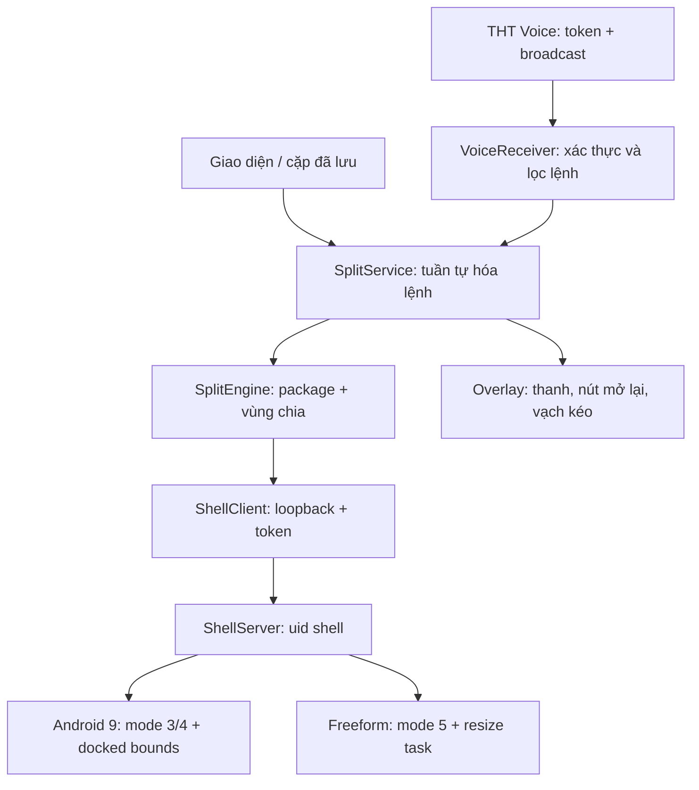
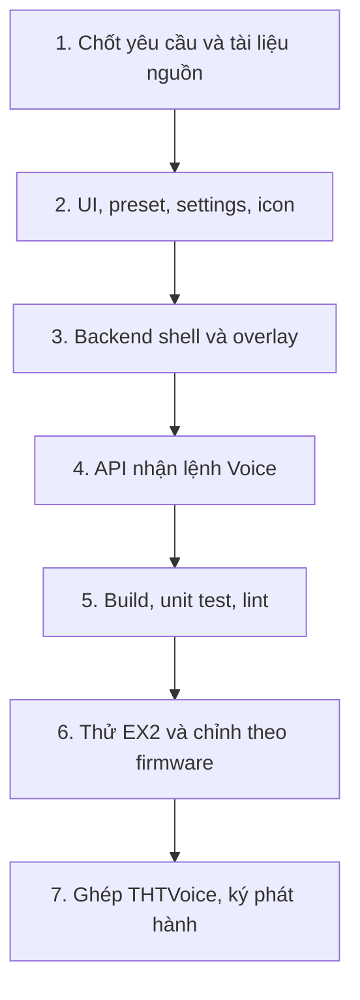

# Kiến trúc và sơ đồ thực hiện

## Luồng lệnh

## Mốc triển khai

Mốc 1–5 đã có mã và kiểm tra máy phát triển. Mốc 6–7 cần thiết bị / tích hợp repo khác.

## Tệp và trách nhiệm
| Tệp | Trách nhiệm |
|---|---|
| MainActivity | Trang chính, cặp đã lưu, 5 nhóm settings |
| Store | SharedPreferences; JSON preset; token bridge/Voice riêng biệt; namespace session tách bản chọn trong UI |
| AppPicker | Tìm kiếm các ứng dụng có launcher; không hard-code app package |
| Ui | Palette, button và icon Canvas đồng đều |
| SplitService | Foreground notification, hàng đợi một tác vụ, overlay và session |
| SplitEngine | Đọc cấu hình, resolve component, tính bounds và gọi bridge |
| core/LayoutMath | Hình học px; chừa OEM bars; clamp ratio 30–70 |
| core/TaskParser | Fallback tìm task trong dumpsys, match package chính xác |
| bridge/ShellClient | Socket 127.0.0.1:39871; timeouts; token |
| bridge/ShellServer | app_process chạy shell; chỉ nhận lệnh allowlist |
| VoiceReceiver | API broadcast explicit; bật/tắt và so token constant time |

Không dùng WebView, dịch vụ cloud, Firebase, root hoặc platform certificate.
GSplit được tham khảo hành vi, không copy nguồn không rõ giấy phép.

## Trạng thái giao diện
| Trạng thái | Diện tích app | Nút nổi |
|---|---|---|
| Thanh mở | Trừ chiều cao thanh, giữ OEM bars | Thanh có ratios + apps/swap/full/home/hide/X |
| Thanh ẩn | Trả lại chiều cao thanh cho 2 app | Chevron để hiện thanh |
| Một app toàn màn | Backend chuyển window mode; không vạch kéo | Nút khôi phục cặp |
| Home | Giữ cặp trong bộ nhớ, bỏ overlay | Mở app/notification để tiếp tục |
| Tắt chia | App trái toàn màn (hoặc app còn lại nếu trái đã đóng) | Dừng service và overlay |

Divider kéo bằng pixel theo tọa độ màn hình; bản đầu cập nhật cửa sổ khi thả để tránh
hàng đợi resize và app OEM bị nhấp nháy. Kéo liên tục/live resize là tối ưu sau thử xe.

## Quyền và giao thức
App thường không được MANAGE_ACTIVITY_STACKS. User mở ADB rồi khởi động ShellServer
qua app_process dưới UID 2000. Shell bridge bind loopback, không mở cổng LAN.
Mỗi kết nối gửi JSON bằng DataOutputStream.writeUTF, nhận JSON bằng readUTF.
Không có lệnh shell tùy ý từ ứng dụng/API. Package/component/mode/bounds được kiểm tra.
Reflection dùng tên method, không binder transaction numbers cố định.

Native Android 9 được ưu tiên. Reflection Android 10+ chỉ là best effort,
không cam kết hỗ trợ firmware mới. Không sửa hidden_api_policy toàn hệ thống.
ShellServer hiện không auto-start sau reboot; APK cập nhật cũng cần chạy lại bridge.

## Build và phân phối
JDK 17 / Gradle 8.9 / AGP 8.7.3 / compile35 / min 26 / target 32.
Target32 dành bản sideload headunit; chỉ tắt lint ExpiredTargetSdkVersion do không đưa
Google Play. Các kiểm tra API/permission khác vẫn chạy, không dùng lint baseline che lỗi.
Không sử dụng khóa ký release trong git. CI build APK debug mỗi lần push main,
artifact giữ 7 ngày. Khóa debug CI thay theo runner; bản CI có thể không cập nhật đè
bản test ký tại máy khác. Cần provisioning khóa ký ngoài repo trước phát hành ổn định.

Cặp/mode/insets đang chạy nằm trong tht_split_session, độc lập với lựa chọn UI chưa áp dụng.
Start nhận selection explicit; preset/restore nhận cấu hình mới, hide/ratio/X thao tác session hiện hành.
