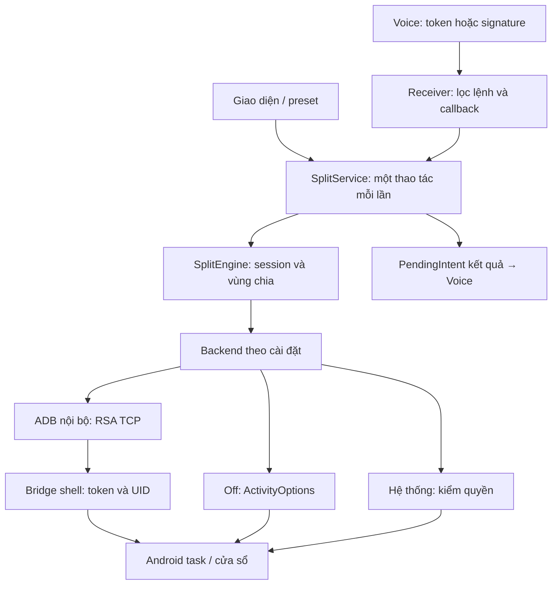

# Kiến trúc THT Split 0.2

- Session giữ transport/mode/insets/cặp độc lập bản chọn UI. Không chuyển phương thức
  khi phiên đang chạy hoặc thao tác đang xử lý. Backend không tự fallback sang cách khác.
- LocalAdb: TCP tới loopback/địa chỉ chính thiết bị, RSA2048, AUTH/SHA1 digest đã băm,
  khung ADB/checksum/stream ID/deadline/giới hạn output. Không có API shell tùy ý.
- ConnectionManager: serialized bootstrap, ping và kiểm UID/version, không kill listener
  lạ. Cổng ADB mặc định5555 khác bridge39871; chỉ bridge bind127.0.0.1.
- Bridge cần được tạo lại sau reboot, nhưng app chuẩn bị lúc boot hoặc trước lệnh.
  Khóa RSA và token vẫn được giữ; lần đầu có thể cần xác nhận khóa trên màn.
- Socket ADB đóng sau bootstrap. Chuyển Off không mở/gửi lệnh shell; daemon bridge
  đã mở trước đó có thể còn sống nhưng không được Off sử dụng. Không tự kill tiến trình.
- Off luôn freeform, geometry không trừ toolbar vì không resize được khi ẩn/hiện;
  toolbar là overlay tạm. Ratio/drag gửi lại launch với bounds mới; không resizeTask, không xác minh được bounds.
  Launch/ratio trả requested, verified=false. Màn chờ overlay chỉ che vùng app,
  worker chờ thêm tối đa3s; không chặn main thread hoặc khẳng định app đã tải xong.
- System dùng MANAGE_ACTIVITY_STACKS được Android cấp; không giả mạo UID/certificates.
  Bản thường không dùng sharedUserId, chỉ cho chọn system nếu quyền thực đã có.
- Scoped hidden API exemptions chỉ trong process ứng dụng; không sửa hidden_api_policy
  toàn hệ thống và không cấp thêm permission. Source thư viện được ghi tại THIRD_PARTY.md.
- API result dùng PendingIntent do Voice/Dashboard tạo; kiểm creator package và requestId,
  không gửi broadcast phản hồi công khai hoặc theo callbackPackage tùy ý.
- Khi overlay hỏng trả error; khi gửi Off trả requested. Unit tests không chứng minh
  nội dung app/insets/cửa sổ trên firmware xe.

## Tệp chính
| Tệp | Trách nhiệm |
|---|---|
| MainActivity / Store | UI/preset/cài đặt và secrets private |
| SplitService / SplitEngine | Tuần tự hóa lệnh, session, overlay và geometry |
| connection/Backend | Chọn một backend, không fallback âm thầm |
| connection/LocalAdb | Khóa RSA private AtomicFile, xác thực/stream TCP |
| core/AdbWire / AdbRsa | Framing, public key Android, chữ ký challenge |
| connection/ConnectionManager | Kiểm tra và bootstrap ShellServer |
| connection/BootReceiver / ConnectionService | Chuẩn bị quyền lúc boot/cập nhật, không tự mở hai app |
| connection/DirectWindows / HiddenAccess | Off và truy cập scoped hidden APIs |
| bridge/ShellClient / ShellServer | Giao thức bridge/token và API task Android9 |
| VoiceReceiver / SignatureVoiceReceiver / VoiceReplies | API token/signature/callback v2 |

## Mốc tiếp tục
Mã cho ADB/Off/system có điều kiện và API phía Split đã có. Còn thử firmware xe,
chữ ký platform nếu có, ghép client trong Voice và ký phát hành ổn định ngoài git.
